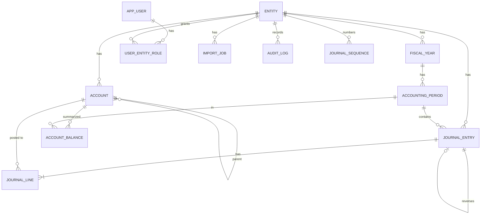
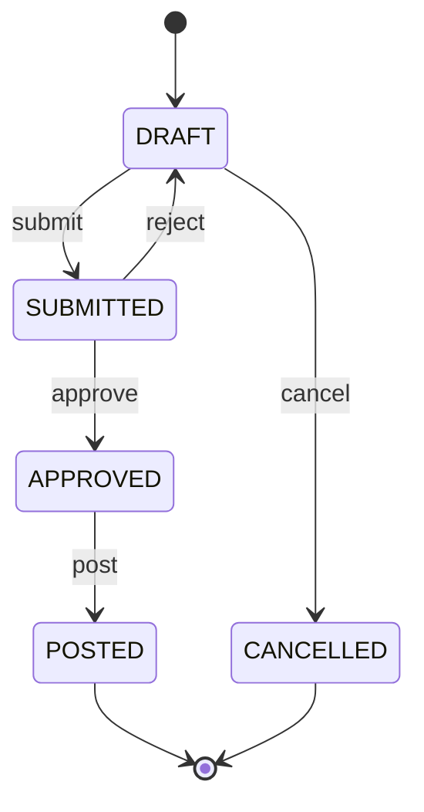
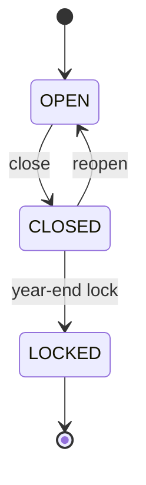

# PRD: Kredo — Enterprise Accounting Platform (General Ledger Core)

| Item | Isi |
|---|---|
| Versi | 1.0 (draft siap dikerjakan) |
| Tanggal | 14 November 2026 |
| Jenis proyek | Proyek portofolio pribadi (edukasi), data fiktif |
| Backend | Java LTS terbaru + Spring Boot + PostgreSQL |
| Frontend | React + TypeScript + Tailwind CSS + shadcn/ui |
| Arsitektur | Modular monolith, REST API, kontrak OpenAPI |
| Estimasi | 14 minggu (setelah Tahap 5 roadmap belajar Java), dengan batas potong yang jelas |

> **Brand:** **Kredo**, dari kata *credo* ("keyakinan, prinsip yang dipegang") dan *kredit* (sisi kanan jurnal). Prinsipnya satu: setiap jurnal harus seimbang, dan setiap angka bisa ditelusuri asalnya.
> **Tagline:** *"Setiap entri, seimbang."* (EN: *"Every entry, in balance."*)
> **Nama teknis:** repo `kredo`, paket Java `com.yourname.kredo`, image Docker `kredo-backend` dan `kredo-frontend`. Ganti `yourname` dengan namamu. Cek ketersediaan nama repo, paket npm, dan domain sebelum dipakai.

> **Catatan versi library:** dokumen ini sengaja tidak mengunci nomor versi. Cek versi stabil terbaru di start.spring.io, dokumentasi PostgreSQL, dan dokumentasi shadcn/ui saat memulai, lalu catat versi yang kamu pakai di README.

---

## Daftar Isi

1. [Ringkasan Produk](#1-ringkasan-produk)
2. [Positioning dan Batasan Jujur](#2-positioning-dan-batasan-jujur)
3. [Persona dan Hak Akses](#3-persona-dan-hak-akses)
4. [Primer Akuntansi](#4-primer-akuntansi)
5. [Scope dan Prioritas](#5-scope-dan-prioritas)
6. [Requirement Fungsional](#6-requirement-fungsional)
7. [Aturan Bisnis dan Invariant](#7-aturan-bisnis-dan-invariant)
8. [Model Data](#8-model-data)
9. [State Machine](#9-state-machine)
10. [Arsitektur](#10-arsitektur)
11. [Keputusan Arsitektur (ADR)](#11-keputusan-arsitektur-adr)
12. [Desain Konsistensi dan Concurrency](#12-desain-konsistensi-dan-concurrency)
13. [Desain API](#13-desain-api)
14. [Frontend](#14-frontend)
15. [Requirement Non-Fungsional](#15-requirement-non-fungsional)
16. [Strategi Testing](#16-strategi-testing)
17. [Rencana Benchmark](#17-rencana-benchmark)
18. [DevOps dan Deployment](#18-devops-dan-deployment)
19. [Struktur Repository](#19-struktur-repository)
20. [Roadmap 14 Minggu](#20-roadmap-14-minggu)
21. [Risiko dan Mitigasi](#21-risiko-dan-mitigasi)
22. [Data Seed dan Contoh COA](#22-data-seed-dan-contoh-coa)
23. [Checklist Showcase Portofolio](#23-checklist-showcase-portofolio)
24. [Aturan Memakai AI di Proyek Ini](#24-aturan-memakai-ai-di-proyek-ini)
25. [Lampiran](#25-lampiran)

---

## 1. Ringkasan Produk

### 1.1 Masalah yang diselesaikan

Perusahaan butuh satu sumber kebenaran untuk catatan keuangannya. Di banyak tempat, data transaksi tersebar di spreadsheet, dikoreksi dengan menimpa angka lama, dan tutup bulan dikerjakan manual sehingga sulit diaudit. Akibatnya laporan keuangan lambat keluar, angkanya sulit dilacak asal-usulnya, dan kesalahan baru ketahuan setelah periode berlalu.

### 1.2 Solusi

**Kredo** adalah platform akuntansi enterprise dengan inti sistem buku besar (*general ledger*) multi-entitas yang:

- mencatat setiap transaksi sebagai **jurnal double-entry** yang selalu seimbang,
- menjalankan alur **maker-checker** (yang menginput tidak boleh yang menyetujui),
- menjaga **periode akuntansi** dan **tutup buku** secara aman terhadap transaksi yang masuk bersamaan,
- tidak pernah mengubah data yang sudah diposting: koreksi dilakukan dengan **jurnal pembalik**,
- mampu **mengimpor ratusan ribu baris jurnal** dan menghasilkan laporan di atas jutaan baris dengan cepat,
- menyimpan **jejak audit** yang tidak bisa dimanipulasi diam-diam.

### 1.3 Tujuan

| Kategori | Tujuan |
|---|---|
| Produk | Pengguna dapat menginput, menyetujui, memposting, dan membalik jurnal; menutup periode; menghasilkan Neraca Saldo, Laba Rugi, dan Neraca yang konsisten |
| Teknis | Membuktikan konsistensi data di bawah concurrency, pemrosesan massal terukur, dan arsitektur modular yang rapi |
| Belajar | Menguasai Spring Boot tingkat lanjut, desain transaksi database, Spring Batch, dan dasar akuntansi |
| Portofolio | Satu repo fullstack dengan README kuat, ADR, bukti benchmark, CI/CD, dan demo yang bisa dicoba |

### 1.4 Indikator keberhasilan

| Indikator | Target |
|---|---|
| Invariant debit = kredit | 0 pelanggaran pada seluruh test, termasuk property-based dan concurrency test |
| Nomor jurnal | 0 celah dan 0 duplikat setelah test 1.000 posting paralel |
| Tutup periode | 0 jurnal lolos ke periode tertutup pada test race condition |
| Impor massal | Hasil identik antara eksekusi 1 thread dan partitioned; dapat dilanjutkan setelah dimatikan paksa |
| Laporan | Neraca Saldo di data besar selesai di bawah target pada bagian 17, dibuktikan dengan angka sebelum dan sesudah optimasi |
| Kualitas | CI hijau, cakupan test domain tinggi, tidak ada secret di riwayat Git |

---

## 2. Positioning dan Batasan Jujur

### 2.1 Status proyek

- Ini **proyek pribadi untuk belajar dan portofolio**, bukan sistem yang pernah dipakai di perusahaan mana pun.
- Semua data adalah **data fiktif** (perusahaan contoh: "PT Maju Jaya Sejahtera", fiktif).
- Sistem **tidak mengklaim** sesuai PSAK, aturan pajak, atau regulasi apa pun, dan bukan pengganti software akuntansi produksi.
- Cantumkan pernyataan ini di README. Di wawancara, ceritakan apa adanya: proyek pribadi yang kamu bangun untuk belajar akuntansi dan backend enterprise, dengan bukti yang bisa diperiksa di GitHub.

### 2.2 Non-goals

Hal-hal berikut **tidak** dikerjakan agar proyek selesai dengan dalam, bukan lebar:

- Modul penjualan, pembelian, stok, atau penggajian (hanya buku besar dan pelaporan)
- Pajak (PPN, PPh), e-Faktur, integrasi DJP
- Konsolidasi antar entitas dan eliminasi intercompany
- Aset tetap dan penyusutan otomatis (bisa jadi stretch goal)
- Integrasi bank sungguhan atau pembayaran sungguhan
- Aplikasi mobile
- Microservices (mulai dan tetap sebagai modular monolith)

---

## 3. Persona dan Hak Akses

### 3.1 Persona

| Persona | Peran | Kebutuhan utama |
|---|---|---|
| **Dina** | Staf akuntansi (maker) | Menginput jurnal cepat lewat keyboard, mengimpor file, melihat status pengajuannya |
| **Raka** | Akuntan senior (checker/approver) | Meninjau antrean persetujuan, menyetujui atau menolak dengan alasan, memposting, membalik jurnal salah |
| **Maya** | Financial controller | Mengelola COA, menutup/membuka periode, melihat semua laporan, memverifikasi rekonsiliasi |
| **Arief** | Auditor internal | Hanya membaca: jurnal, laporan, dan jejak audit; menelusuri angka sampai ke jurnal asal |
| **Sari** | Administrator sistem | Mengelola pengguna, entitas, dan role; tidak ikut membuat atau menyetujui jurnal |

### 3.2 Matriks permission

Role diberikan **per entitas** (satu pengguna bisa Accountant di entitas A dan Auditor di entitas B).

| Permission | Admin | Accountant | Approver | Controller | Auditor |
|---|:-:|:-:|:-:|:-:|:-:|
| `user:manage` | ✓ | | | | |
| `entity:manage` | ✓ | | | | |
| `coa:view` | ✓ | ✓ | ✓ | ✓ | ✓ |
| `coa:manage` | | | | ✓ | |
| `journal:view` | | ✓ | ✓ | ✓ | ✓ |
| `journal:create` (draft, submit) | | ✓ | ✓ | ✓ | |
| `journal:approve` | | | ✓ | ✓ | |
| `journal:post` | | | ✓ | ✓ | |
| `journal:reverse` | | | ✓ | ✓ | |
| `period:view` | | ✓ | ✓ | ✓ | ✓ |
| `period:manage` (tutup/buka) | | | | ✓ | |
| `import:run` (sebagai draft) | | ✓ | ✓ | ✓ | |
| `import:autopost` | | | | ✓ | |
| `report:view` | | ✓ | ✓ | ✓ | ✓ |
| `report:export` | | ✓ | ✓ | ✓ | ✓ |
| `audit:view` | ✓ | | | ✓ | ✓ |

Aturan tambahan yang **tidak bisa dilanggar oleh role apa pun**: pembuat jurnal tidak boleh menyetujui jurnal yang sama (maker-checker).

---

## 4. Primer Akuntansi

> Bagian ini ringkasan untuk membangun sistemnya. Pelajari dari materi akuntansi yang kredibel juga (lihat bagian 25), jangan hanya mengandalkan AI atau dokumen ini.

### 4.1 Persamaan dasar

```text
Aset = Liabilitas + Ekuitas
(yang dimiliki)  (utang)    (modal pemilik)
```

### 4.2 Lima jenis akun dan saldo normalnya

| Jenis akun | Contoh | Bertambah di | Berkurang di | Saldo normal |
|---|---|---|---|---|
| Aset | Kas, Piutang, Persediaan | Debit | Kredit | Debit |
| Beban | Gaji, Sewa, Harga Pokok Penjualan | Debit | Kredit | Debit |
| Liabilitas | Utang Usaha, Utang Bank | Kredit | Debit | Kredit |
| Ekuitas | Modal Saham, Laba Ditahan | Kredit | Debit | Kredit |
| Pendapatan | Penjualan, Pendapatan Jasa | Kredit | Debit | Kredit |

**Aturan emas:** setiap jurnal memiliki total debit yang sama dengan total kredit.

### 4.3 Contoh jurnal (PT Maju Jaya, fiktif)

```text
1. Pemilik menyetor modal Rp 100.000.000
   Debit  Kas                       100.000.000
   Kredit Modal Saham                              100.000.000

2. Beli persediaan tunai Rp 20.000.000
   Debit  Persediaan                  20.000.000
   Kredit Kas                                       20.000.000

3. Jual barang kredit Rp 15.000.000 (harga pokok Rp 9.000.000)
   Debit  Piutang Usaha               15.000.000
   Kredit Penjualan                                 15.000.000
   Debit  Harga Pokok Penjualan        9.000.000
   Kredit Persediaan                                 9.000.000

4. Bayar gaji Rp 5.000.000
   Debit  Beban Gaji                   5.000.000
   Kredit Kas                                        5.000.000
```

### 4.4 Alur akuntansi yang disistemkan

```text
Kejadian → Jurnal (draft → disetujui) → Posting ke buku besar
        → Neraca Saldo → (penyesuaian) → Laporan keuangan → Tutup periode → Tutup tahun
```

| Konsep | Arti dalam sistem |
|---|---|
| **Jurnal** | Catatan transaksi berisi minimal dua baris, debit sama dengan kredit |
| **Posting** | Jurnal yang disetujui dicatat permanen ke buku besar dan memengaruhi saldo |
| **Buku besar** | Kumpulan semua baris jurnal terposting, dikelompokkan per akun |
| **Neraca Saldo** | Daftar saldo semua akun; total debit harus sama dengan total kredit |
| **Laba Rugi** | Pendapatan dikurangi beban dalam rentang waktu |
| **Neraca** | Posisi aset, liabilitas, dan ekuitas pada tanggal tertentu |
| **Periode** | Rentang bulan akuntansi yang bisa dibuka atau ditutup |
| **Tutup tahun** | Saldo akun pendapatan dan beban dipindahkan ke Laba Ditahan lewat jurnal penutup |
| **Jurnal pembalik** | Jurnal baru dengan debit dan kredit ditukar untuk mengoreksi jurnal salah |

Sistem memakai **basis akrual** (transaksi dicatat saat terjadi, bukan saat kas bergerak) dan satu mata uang dasar (IDR) di MVP.

---

## 5. Scope dan Prioritas

| Prioritas | Arti | Isi |
|---|---|---|
| **P0 (MVP)** | Wajib, tanpa ini proyek tidak layak dipamerkan | Auth+RBAC, entitas, COA, periode, jurnal (draft-submit-approve-post), pembalik, buku besar, laporan (GL, TB, Laba Rugi, Neraca), impor massal, audit log, ekspor CSV/XLSX |
| **P1** | Penting, dikerjakan setelah P0 stabil | Tutup tahun, buka kembali periode, batas persetujuan nominal, dashboard, ekspor PDF, verifikasi hash audit, lockout login, impor COA |
| **P2 (stretch)** | Hanya jika waktu sisa | Jurnal berulang, outbox + Kafka, i18n, Row-Level Security, lampiran dokumen, multi-currency |
| **Out of scope** | Tidak dikerjakan | Lihat bagian 2.2 |

**Garis potong jika waktu mepet** (urutan yang dipotong lebih dulu): P2 semuanya, lalu dashboard, ekspor PDF, impor COA, lockout. **Jangan dipotong:** tutup periode, impor massal, concurrency test, benchmark, dan ADR.

---

## 6. Requirement Fungsional

Format: **ID — [Prioritas] Deskripsi.** Di bawahnya, kriteria penerimaan (*acceptance criteria*, AC).

### 6.1 Identity & Access (AUTH)

- **FR-AUTH-01 [P0]** Login dengan email dan password. Access token JWT berumur pendek (±15 menit), refresh token memakai rotasi dan disimpan di cookie `HttpOnly`, `Secure`, `SameSite=Strict`.
  - AC: access token disimpan di memori frontend (bukan localStorage); refresh menghasilkan refresh token baru dan mencabut yang lama.
- **FR-AUTH-02 [P0]** RBAC berbasis permission per entitas (bagian 3.2). Pengecekan dilakukan di backend pada setiap endpoint, bukan hanya disembunyikan di UI.
  - AC: tiap endpoint punya test "tanpa permission → 403" dan "entitas lain → 404/403".
- **FR-AUTH-03 [P0]** Logout mencabut refresh token. Pemakaian ulang refresh token yang sudah dirotasi dianggap pencurian: seluruh rangkaian token pengguna dicabut dan dicatat di audit.
- **FR-AUTH-04 [P1]** Rate limit login dan penguncian sementara setelah 5 kali gagal.
- **FR-AUTH-05 [P1]** Admin mengelola pengguna: buat, nonaktifkan, atur role per entitas.
- Password di-hash dengan algoritma yang kuat (Argon2id atau BCrypt dengan cost memadai). Tidak ada password di log.

### 6.2 Entitas (ENT)

- **FR-ENT-01 [P0]** Membuat entitas: kode unik, nama, mata uang dasar (IDR), bulan awal tahun fiskal.
- **FR-ENT-02 [P0]** **Isolasi data**: setiap query data bisnis wajib memakai `entity_id` dan pengguna hanya bisa mengakses entitas yang ditugaskan.
  - AC: test lintas-entitas (pengguna entitas A mencoba membaca jurnal, akun, laporan entitas B) selalu gagal.
- **FR-ENT-03 [P1]** Pemilih entitas di UI, dan entitas aktif ikut di setiap request.
- **FR-ENT-04 [P2]** Row-Level Security PostgreSQL sebagai lapisan pertahanan tambahan.

### 6.3 Chart of Accounts (COA)

- **FR-COA-01 [P0]** CRUD akun: kode (unik per entitas), nama, jenis (5 jenis), saldo normal (diturunkan dari jenis), akun induk, flag `postable`, `report_group`.
- **FR-COA-02 [P0]** Struktur pohon maksimal 5 level. Hanya akun daun yang `postable`. Jenis akun anak harus sama dengan induknya.
- **FR-COA-03 [P0]** Akun yang sudah punya baris terposting **tidak bisa dihapus dan tidak bisa diubah jenisnya**. Boleh dinonaktifkan; akun nonaktif tidak bisa dipakai di jurnal baru tapi tetap tampil di laporan.
- **FR-COA-04 [P0]** Template COA awal (lihat bagian 22) bisa dimuat saat membuat entitas.
- **FR-COA-05 [P1]** Impor COA dari CSV dengan validasi.

### 6.4 Periode Akuntansi (PER)

- **FR-PER-01 [P0]** Membuat tahun fiskal otomatis menghasilkan 12 periode bulanan.
- **FR-PER-02 [P0]** Status periode: `OPEN`, `CLOSED`, `LOCKED`.
- **FR-PER-03 [P0]** **Tutup periode** oleh Controller. Prasyarat: tidak ada jurnal berstatus `DRAFT/SUBMITTED/APPROVED` di periode itu (atau dipindahkan/dibatalkan), dan Neraca Saldo seimbang. Tercatat siapa, kapan, dan alasan.
- **FR-PER-04 [P0]** Periode `CLOSED` menolak posting. Penolakan harus aman terhadap posting yang sedang berjalan bersamaan (bagian 12).
- **FR-PER-05 [P1]** Buka kembali periode `CLOSED` dengan alasan wajib dan audit. Periode `LOCKED` tidak bisa dibuka.
- **FR-PER-06 [P1]** **Tutup tahun**: menghasilkan jurnal penutup (pendapatan dan beban ke Laba Ditahan), lalu mengunci seluruh periode tahun itu.

### 6.5 Jurnal (JRN)

- **FR-JRN-01 [P0]** Membuat jurnal draft: tanggal, deskripsi, referensi opsional, minimal 2 baris (akun, debit atau kredit, memo).
- **FR-JRN-02 [P0]** Validasi: total debit = total kredit; nilai > 0; tepat satu sisi (debit atau kredit) per baris; maksimal 2 desimal untuk IDR (**tidak ada pembulatan diam-diam**, ditolak jika lebih); akun `postable`, aktif, dan milik entitas yang sama; tanggal berada di periode `OPEN`.
- **FR-JRN-03 [P0]** Siklus status: `DRAFT → SUBMITTED → APPROVED → POSTED`. Penolakan mengembalikan ke `DRAFT` dengan alasan wajib. Draft bisa `CANCELLED`.
- **FR-JRN-04 [P0]** **Maker-checker**: pengaju dan pembuat tidak boleh menjadi penyetuju. Ditegakkan di domain dan dibuktikan dengan test.
- **FR-JRN-05 [P0]** **Posting**: jurnal mendapat nomor berurutan tanpa celah, format `JV-{KODE_ENTITAS}-{TAHUN}-{000001}`. Setelah diposting jurnal **immutable**.
- **FR-JRN-06 [P0]** **Jurnal pembalik**: satu klik menghasilkan jurnal dengan debit-kredit ditukar, bertanggal di periode terbuka, tertaut ke jurnal asal. Satu jurnal hanya bisa dibalik sekali, dan jurnal pembalik tidak bisa dibalik lagi.
- **FR-JRN-07 [P0]** Pencarian dan filter: rentang tanggal, status, akun, nomor, rentang nominal, teks, pembuat; paginasi.
- **FR-JRN-08 [P0]** **Idempotensi**: pembuatan dan posting jurnal menerima header `Idempotency-Key`; request ulang dengan kunci yang sama tidak menghasilkan duplikat.
- **FR-JRN-09 [P0]** Edit draft memakai **optimistic locking** (`version`). Konflik mengembalikan 409 dengan pesan yang jelas.
- **FR-JRN-10 [P0]** Riwayat status jurnal (siapa, kapan, dari-ke, alasan) tampil sebagai linimasa.
- **FR-JRN-11 [P1]** **Batas persetujuan**: jurnal dengan total di atas nominal tertentu hanya bisa disetujui Controller.
- **FR-JRN-12 [P2]** Template jurnal berulang (mis. sewa bulanan) yang dijalankan scheduler.

### 6.6 Buku Besar dan Saldo (LED)

- **FR-LED-01 [P0]** Posting memperbarui tabel ringkasan saldo per (akun, periode) **dalam transaksi yang sama** dengan perubahan status jurnal.
- **FR-LED-02 [P0]** Buku besar per akun: saldo awal, daftar baris, saldo berjalan (*running balance*), paginasi berbasis kursor.
- **FR-LED-03 [P0]** **Rekonsiliasi**: job yang menghitung ulang saldo dari baris jurnal dan membandingkannya dengan tabel ringkasan; selisih memicu alert dan tercatat di audit.
- **FR-LED-04 [P1]** Job membangun ulang seluruh tabel ringkasan dari baris jurnal (untuk pemulihan).

### 6.7 Impor Massal (IMP)

- **FR-IMP-01 [P0]** Unggah CSV dengan kolom: `journal_ref, entry_date, description, account_code, debit, credit, memo`. Baris dengan `journal_ref` sama membentuk satu jurnal. Baris satu jurnal harus berurutan di file (didokumentasikan; pelanggaran dilaporkan sebagai error).
- **FR-IMP-02 [P0]** Diproses dengan **Spring Batch**: chunk, dapat dilanjutkan dari titik gagal (*restartable*), dan dapat diparalelkan (*partitioning*). Pemecahan partisi tidak boleh memotong satu grup jurnal.
- **FR-IMP-03 [P0]** Validasi per jurnal: seimbang, akun valid, periode terbuka. Jurnal gagal masuk laporan error per baris dan **tidak** menggagalkan jurnal lain.
- **FR-IMP-04 [P0]** Idempotensi: file yang sama (hash isi, per entitas) tidak diproses dua kali kecuali dipaksa.
- **FR-IMP-05 [P0]** API status dan progres job, serta unduhan CSV error.
- **FR-IMP-06 [P1]** Opsi hasil impor: sebagai `DRAFT` (perlu persetujuan) atau langsung `POSTED` (butuh permission `import:autopost`).
- Batas ukuran file dan jumlah baris dikonfigurasi. File divalidasi (ekstensi, ukuran, encoding), bukan hanya dipercaya dari nama.

### 6.8 Pelaporan (RPT)

Semua laporan hanya membaca jurnal berstatus `POSTED`.

- **FR-RPT-01 [P0]** Buku Besar per akun dan rentang tanggal.
- **FR-RPT-02 [P0]** **Neraca Saldo** per periode: saldo awal, mutasi debit, mutasi kredit, saldo akhir; menampilkan pengecekan total debit = total kredit.
- **FR-RPT-03 [P0]** **Laba Rugi** untuk rentang periode: Pendapatan − Harga Pokok − Beban = Laba Bersih. Perbandingan dengan periode sebelumnya [P1].
- **FR-RPT-04 [P0]** **Neraca** per tanggal: Aset = Liabilitas + Ekuitas, termasuk laba berjalan tahun ini; menampilkan baris pengecekan keseimbangan.
- **FR-RPT-05 [P0]** Ekspor CSV dan XLSX (streaming, aman untuk data besar). Ekspor PDF [P1].
- **FR-RPT-06 [P1]** Register jurnal (daftar jurnal terposting per rentang tanggal).
- Ekspor **harus mencegah CSV/formula injection** (sel yang diawali `=`, `+`, `-`, `@` di-escape).
- Laporan yang menggabungkan beberapa angka (mis. Neraca) dibaca dalam **satu snapshot transaksi** agar konsisten (bagian 12.6).

### 6.9 Audit (AUD)

- **FR-AUD-01 [P0]** Setiap perubahan status dan kejadian keamanan (login, gagal login, perubahan role, tutup/buka periode, impor) tercatat: siapa, kapan, apa, ringkasan sebelum-sesudah, IP, correlation id.
- **FR-AUD-02 [P0]** Tabel audit **append-only**: update dan delete diblokir di level database.
- **FR-AUD-03 [P1]** **Penyegelan hash**: job berkala menghitung hash blok baris audit yang belum tersegel dan merantainya dengan hash blok sebelumnya; endpoint verifikasi mendeteksi manipulasi.

### 6.10 Dashboard (DSH)

- **FR-DSH-01 [P1]** Ringkasan: pendapatan, beban, dan laba bersih bulan berjalan dan tahun berjalan; saldo kas; jumlah jurnal menunggu persetujuan; status periode. Satu grafik pendapatan vs beban per bulan.

### 6.11 Event (EVT)

- **FR-EVT-01 [P2]** Pola **transactional outbox**: event `JournalPosted`, `PeriodClosed` ditulis ke tabel outbox dalam transaksi yang sama, lalu dipublikasikan ke Kafka oleh relay.

---

## 7. Aturan Bisnis dan Invariant

Invariant adalah kebenaran yang **tidak boleh pernah dilanggar**. Tiap invariant dijaga di lebih dari satu lapisan (*defense in depth*) dan punya test.

| ID | Invariant | Dijaga di |
|---|---|---|
| INV-01 | Jurnal terposting: Σ debit = Σ kredit | Domain, constraint trigger database, property-based test |
| INV-02 | Jurnal terposting immutable (tidak ada update/delete baris jurnal dan barisnya) | Trigger database, hak akses DB user aplikasi, integration test |
| INV-03 | Nomor jurnal per (entitas, tahun fiskal) berurutan, unik, tanpa celah | Tabel counter + row lock, concurrency test |
| INV-04 | Posting hanya ke periode `OPEN`; periode ditentukan dari tanggal jurnal | Service + lock periode, race test |
| INV-05 | Baris jurnal hanya ke akun `postable`, aktif, dan satu entitas dengan jurnal | Domain, FK komposit, test |
| INV-06 | Pembuat/pengaju ≠ penyetuju | Domain, test |
| INV-07 | Uang memakai `NUMERIC(19,4)` dan `BigDecimal`, tidak pernah float/double; nilai berskala lebih dari 2 ditolak | Tipe data, validasi, test |
| INV-08 | Σ debit semua jurnal terposting = Σ kredit semua jurnal terposting (per entitas) | Rekonsiliasi, test |
| INV-09 | `account_balance` = hasil hitung ulang dari baris jurnal terposting | Job rekonsiliasi, test |
| INV-10 | Satu jurnal punya paling banyak satu pembalik; pembalik bernilai berlawanan persis | Unique constraint, domain, test |
| INV-11 | Neraca: Aset = Liabilitas + Ekuitas + Laba berjalan | Pengecekan di laporan, test |
| INV-12 | Data satu entitas tidak terlihat oleh entitas lain | Query wajib `entity_id`, test lintas-entitas |
| INV-13 | Periode `LOCKED` tidak dapat dibuka; tahun yang sudah ditutup tidak menerima posting | Domain, test |
| INV-14 | Audit log append-only | Trigger database, hak akses DB, test |

---

## 8. Model Data

### 8.1 ERD



### 8.2 Daftar tabel

| Tabel | Isi |
|---|---|
| `entity` | Perusahaan: kode, nama, mata uang dasar, bulan awal tahun fiskal |
| `app_user`, `user_entity_role`, `refresh_token` | Pengguna, role per entitas, rotasi refresh token |
| `account` | COA berpohon: kode, nama, `type`, `normal_balance`, `parent_id`, `is_postable`, `is_active`, `report_group`, `version` |
| `fiscal_year`, `accounting_period` | Kalender fiskal dan status periode |
| `journal_entry` | Header jurnal: status, tanggal, periode, nomor (null sampai diposting), sumber, tautan pembalik, jejak pembuat/pengaju/penyetuju/pemosting, `version` |
| `journal_line` | Baris jurnal: akun, debit, kredit, memo (ditargetkan **dipartisi per rentang tanggal**) |
| `journal_status_history` | Linimasa perubahan status per jurnal |
| `account_balance` | Ringkasan debit dan kredit per (akun, periode) untuk laporan cepat |
| `journal_sequence` | Counter nomor jurnal per (entitas, tahun fiskal) |
| `idempotency_record` | Kunci idempotensi, hash request, respons tersimpan |
| `import_job`, `import_row_error` | Status impor dan error per baris (ditambah tabel metadata Spring Batch) |
| `audit_log`, `audit_seal` | Log append-only dan segel hash berantai |
| `outbox_event` | (P2) event untuk dipublikasikan ke Kafka |

### 8.3 Cuplikan skema kunci

> Ini rancangan acuan. Kamu menulis migrasi Flyway-nya sendiri dan boleh menyesuaikannya.

```sql
-- Akun
CREATE TABLE account (
  id            BIGINT GENERATED ALWAYS AS IDENTITY PRIMARY KEY,
  entity_id     BIGINT NOT NULL REFERENCES entity(id),
  code          VARCHAR(20)  NOT NULL,
  name          VARCHAR(150) NOT NULL,
  type          VARCHAR(10)  NOT NULL
                CHECK (type IN ('ASSET','LIABILITY','EQUITY','REVENUE','EXPENSE')),
  normal_balance VARCHAR(6)  NOT NULL CHECK (normal_balance IN ('DEBIT','CREDIT')),
  report_group  VARCHAR(30)  NOT NULL,   -- CASH, CURRENT_ASSET, COGS, OPEX, ...
  parent_id     BIGINT REFERENCES account(id),
  is_postable   BOOLEAN NOT NULL DEFAULT TRUE,
  is_active     BOOLEAN NOT NULL DEFAULT TRUE,
  version       BIGINT  NOT NULL DEFAULT 0,
  UNIQUE (entity_id, code)
);

-- Header jurnal
CREATE TABLE journal_entry (
  id             BIGINT GENERATED ALWAYS AS IDENTITY PRIMARY KEY,
  entity_id      BIGINT NOT NULL REFERENCES entity(id),
  period_id      BIGINT NOT NULL REFERENCES accounting_period(id),
  journal_no     VARCHAR(40),                      -- null sampai POSTED
  entry_date     DATE NOT NULL,
  description    VARCHAR(500) NOT NULL,
  source         VARCHAR(12) NOT NULL              -- MANUAL | IMPORT | REVERSAL | CLOSING | OPENING
                 CHECK (source IN ('MANUAL','IMPORT','REVERSAL','CLOSING','OPENING')),
  status         VARCHAR(10) NOT NULL
                 CHECK (status IN ('DRAFT','SUBMITTED','APPROVED','POSTED','CANCELLED')),
  reversal_of_id BIGINT REFERENCES journal_entry(id),
  total_amount   NUMERIC(19,4) NOT NULL,
  created_by     BIGINT NOT NULL,
  submitted_by   BIGINT,
  approved_by    BIGINT,
  posted_by      BIGINT,
  posted_at      TIMESTAMPTZ,
  version        BIGINT NOT NULL DEFAULT 0,        -- optimistic locking
  UNIQUE (entity_id, journal_no),
  UNIQUE (reversal_of_id)                          -- satu pembalik per jurnal
);

-- Baris jurnal (dipartisi per entry_date pada fase optimasi)
CREATE TABLE journal_line (
  id          BIGINT GENERATED ALWAYS AS IDENTITY,
  entry_id    BIGINT NOT NULL REFERENCES journal_entry(id),
  entity_id   BIGINT NOT NULL,
  entry_date  DATE   NOT NULL,                     -- denormalisasi untuk partisi & query rentang
  line_no     INT    NOT NULL,
  account_id  BIGINT NOT NULL REFERENCES account(id),
  debit       NUMERIC(19,4) NOT NULL DEFAULT 0,
  credit      NUMERIC(19,4) NOT NULL DEFAULT 0,
  memo        VARCHAR(255),
  PRIMARY KEY (id, entry_date),
  CHECK (debit >= 0 AND credit >= 0),
  CHECK ((debit = 0) <> (credit = 0))              -- tepat salah satu sisi terisi
);
CREATE INDEX ix_line_account_date ON journal_line (account_id, entry_date);
CREATE INDEX ix_line_entry        ON journal_line (entry_id);

-- Ringkasan saldo per (akun, periode)
CREATE TABLE account_balance (
  account_id   BIGINT NOT NULL REFERENCES account(id),
  period_id    BIGINT NOT NULL REFERENCES accounting_period(id),
  entity_id    BIGINT NOT NULL,
  debit_total  NUMERIC(19,4) NOT NULL DEFAULT 0,
  credit_total NUMERIC(19,4) NOT NULL DEFAULT 0,
  line_count   BIGINT NOT NULL DEFAULT 0,
  PRIMARY KEY (account_id, period_id)
);

-- Counter nomor jurnal
CREATE TABLE journal_sequence (
  entity_id   BIGINT NOT NULL REFERENCES entity(id),
  fiscal_year INT    NOT NULL,
  last_number BIGINT NOT NULL DEFAULT 0,
  PRIMARY KEY (entity_id, fiscal_year)
);

-- Audit (append-only)
CREATE TABLE audit_log (
  id             BIGINT GENERATED ALWAYS AS IDENTITY PRIMARY KEY,
  entity_id      BIGINT,
  actor_id       BIGINT,
  action         VARCHAR(60) NOT NULL,
  target_type    VARCHAR(40),
  target_id      BIGINT,
  detail         JSONB NOT NULL,
  ip             INET,
  correlation_id UUID,
  occurred_at    TIMESTAMPTZ NOT NULL DEFAULT now(),
  seal_id        BIGINT                              -- diisi job penyegelan
);
```

### 8.4 Penegakan di level database (defense in depth)

- **Trigger pemblokir**: `BEFORE UPDATE OR DELETE` pada `journal_line` dan pada `journal_entry` yang berstatus `POSTED` melempar error. Hal yang sama untuk `audit_log`.
- **Constraint trigger tertunda (`DEFERRABLE INITIALLY DEFERRED`)** yang pada saat commit memastikan jurnal berstatus `POSTED` memiliki Σ debit = Σ kredit.
- **Hak akses**: user DB aplikasi tidak diberi hak `DELETE`/`TRUNCATE` pada tabel jurnal dan audit. Migrasi dijalankan dengan user terpisah.
- **Catatan partisi**: pada tabel terpartisi, primary key harus menyertakan kolom partisi (`entry_date`). Rencanakan migrasi partisi sebagai langkah optimasi terukur di minggu 9-10, bukan di awal.

### 8.5 Saldo awal dan perhitungan saldo

- Saldo awal sebuah akun dicatat sebagai **jurnal bersumber `OPENING`**, bukan kolom khusus, agar semuanya tetap bisa diaudit.
- Saldo akhir akun bersaldo normal debit = Σ debit − Σ kredit; bersaldo normal kredit = Σ kredit − Σ debit.
- Laba berjalan tahun ini = Σ saldo akun `REVENUE` − Σ saldo akun `EXPENSE` dari awal tahun fiskal sampai tanggal laporan.

---

## 9. State Machine

### 9.1 Jurnal



| Transisi | Siapa | Prasyarat |
|---|---|---|
| `DRAFT → SUBMITTED` | Pembuat (`journal:create`) | Lolos validasi lengkap (FR-JRN-02) |
| `SUBMITTED → APPROVED` | `journal:approve` | Penyetuju ≠ pembuat dan ≠ pengaju; di bawah batas nominal (atau Controller) |
| `SUBMITTED → DRAFT` | `journal:approve` | Alasan penolakan wajib |
| `APPROVED → POSTED` | `journal:post` | Periode `OPEN`, akun masih valid, seimbang; nomor dialokasikan |
| `DRAFT → CANCELLED` | Pembuat | Hanya dari draft |
| `POSTED → (dibalik)` | `journal:reverse` | Belum pernah dibalik; bukan jurnal pembalik |

Endpoint `approve` menerima opsi `post=true` untuk menyetujui dan memposting **dalam satu transaksi** (menghindari status menggantung di antara dua request).

### 9.2 Periode



---

## 10. Arsitektur

### 10.1 Gaya arsitektur: modular monolith

Satu aplikasi Spring Boot yang dibagi menjadi **modul dengan batas yang tegas**, satu database PostgreSQL. Alasannya: transaksi akuntansi butuh konsistensi kuat (posting mengubah header, baris, saldo, nomor, dan audit sekaligus). Memecah ke microservices memaksa transaksi terdistribusi dan kompleksitas operasional yang tidak memberi nilai di skala ini. Modul yang bersih tetap bisa dipisah nanti jika perlu.

### 10.2 Gambaran sistem

```text
                        ┌──────────────────────────────────────────┐
 Browser                │              Spring Boot (JVM)           │
 React + shadcn/ui ───► │  REST API  /api/v1  (OpenAPI)            │
  (TanStack Query)  JWT │   ├─ identity   ├─ ledger     ├─ audit   │
                        │   ├─ entity     ├─ importer   ├─ reporting│
                        │   ├─ coa        ├─ period     └─ journal │
                        │   └─ shared kernel                       │
                        └───────────┬──────────────────────────────┘
                                    │ JDBC (HikariCP)
                          ┌─────────▼─────────┐        (P2)
                          │    PostgreSQL     │───────► outbox ─► Kafka
                          └───────────────────┘
        Spring Batch (job import) berjalan di proses yang sama, state di PostgreSQL
```

### 10.3 Modul backend

| Modul | Tanggung jawab | Boleh bergantung pada |
|---|---|---|
| `shared` | Tipe dasar (`Money`, `EntityId`), error, utilitas, konfigurasi umum | (tidak ada) |
| `identity` | User, role, token, permission | `shared` |
| `organization` | Entitas dan keanggotaan | `shared`, `identity` |
| `coa` | Akun dan pohonnya | `shared`, `organization` |
| `period` | Tahun fiskal, periode, tutup/buka | `shared`, `organization` |
| `journal` | Jurnal, siklus status, validasi, nomor, pembalik | `shared`, `coa`, `period`, `organization` |
| `ledger` | Saldo ringkasan, buku besar, rekonsiliasi | `shared`, `coa`, `period` |
| `importer` | Impor CSV (Spring Batch) | `journal` lewat API publik modul |
| `reporting` | Laporan dan ekspor | `shared`, `coa`, `period`, `ledger` |
| `audit` | Log, penyegelan hash | `shared` |

**Aturan:** modul hanya memanggil **API publik modul lain** (interface + DTO di paket `api`), tidak mengakses repository atau entitas internalnya. Aturan ini diverifikasi otomatis dengan **Spring Modulith** (`ApplicationModules.verify()`) atau **ArchUnit**, dan dijalankan di CI.

### 10.4 Struktur di dalam modul

Pragmatis, bukan dogma. Logika bisnis penting hidup di `domain` sebagai Java murni (mudah dites tanpa Spring).

```text
journal/
├── api/              # antarmuka publik modul + DTO lintas modul
├── web/              # controller REST, request/response DTO, mapper
├── application/      # use case: SubmitJournal, PostJournal, ReverseJournal (@Transactional)
├── domain/           # Journal, JournalLine, aturan validasi, state machine, Money
└── infrastructure/   # repository JPA/JDBC, adapter (sequence, balance upsert)
```

Contoh struktur paket:

```text
com.yourname.kredo
├── KredoApplication.java
├── shared/
├── identity/ ├── organization/ ├── coa/ ├── period/
├── journal/  ├── ledger/       ├── importer/ ├── reporting/ └── audit/
```

### 10.5 Tech stack

| Lapisan | Pilihan | Catatan |
|---|---|---|
| Bahasa/Runtime | Java LTS terbaru, virtual threads bila relevan | Catat versi di README |
| Framework | Spring Boot, Spring Web, Spring Security, Spring Data JPA, Spring Batch, Spring Modulith (opsional), Actuator | |
| Database | PostgreSQL versi stabil terbaru | Fitur yang dipakai: `NUMERIC`, `JSONB`, partisi, constraint trigger, advisory/row lock |
| Akses data | **JPA/Hibernate** untuk agregat CRUD; **`JdbcClient`/jOOQ** untuk posting, upsert saldo, dan laporan | Lihat ADR-005 |
| Migrasi | Flyway | |
| Validasi/Mapping | Jakarta Validation, MapStruct | |
| Dokumentasi API | springdoc-openapi | Sumber kontrak untuk frontend |
| Ekspor | Apache POI (streaming `SXSSF`) atau FastExcel untuk XLSX; OpenPDF untuk PDF | |
| Testing | JUnit 5, Mockito, AssertJ, Testcontainers, jqwik, ArchUnit, JaCoCo | |
| Observability | Micrometer + Prometheus, log JSON, OpenTelemetry (opsional) | |
| Frontend | React, TypeScript, Vite, Tailwind CSS, shadcn/ui | Bagian 14 |
| Infra | Docker, Docker Compose, GitHub Actions, reverse proxy dengan TLS (Caddy/Traefik) | |

### 10.6 Lintas modul (cross-cutting)

- **Error handling:** `@RestControllerAdvice` menghasilkan `application/problem+json` (RFC 9457) dengan kode error stabil (bagian 13.3).
- **Validasi:** di batas API (Jakarta Validation) dan di domain (aturan bisnis). Domain tidak percaya input controller.
- **Transaksi:** satu use case = satu `@Transactional` di lapisan `application`. Controller tidak memegang transaksi.
- **Konfigurasi:** `application.yml` + profil `dev`/`test`/`prod`; secret hanya dari environment variable.
- **Correlation id:** filter menyisipkan `traceId` ke log, respons, dan audit.

---

## 11. Keputusan Arsitektur (ADR)

Tulis tiap keputusan sebagai berkas di `docs/adr/` memakai template: **Konteks → Keputusan → Alternatif → Konsekuensi (trade-off)**. Berikut daftar awal beserta alasannya.

| ADR | Keputusan | Alternatif | Trade-off utama |
|---|---|---|---|
| 001 | Modular monolith | Microservices | Konsistensi transaksi sederhana; skalabilitas per modul lebih terbatas |
| 002 | PostgreSQL sebagai satu-satunya datastore | + Redis/Mongo | Operasional sederhana; fitur Postgres dipakai maksimal |
| 003 | `NUMERIC(19,4)` + `BigDecimal`; di JSON uang sebagai **string** | double, integer sen | Presisi aman; butuh disiplin parsing di frontend |
| 004 | Nomor jurnal dari **tabel counter + row lock** | `SEQUENCE` Postgres | Tanpa celah (syarat audit), tapi posting per entitas-tahun terserialisasi; transaksi dijaga pendek |
| 005 | JPA untuk CRUD, **SQL eksplisit** untuk posting dan laporan | JPA untuk semua | Kontrol penuh atas locking dan performa; dua gaya akses data |
| 006 | Saldo ringkasan `account_balance` diperbarui **sinkron** saat posting | Hitung dari baris saat laporan; materialized view | Laporan cepat dan konsisten; posting sedikit lebih berat dan perlu rekonsiliasi |
| 007 | Koreksi lewat **jurnal pembalik**, bukan edit | Edit dengan versi | Jejak audit jujur; jumlah jurnal bertambah |
| 008 | Lock periode: posting `FOR SHARE`, tutup periode `FOR UPDATE` | Lock aplikasi, flag cache | Penutupan menunggu posting berjalan, posting setelah tutup ditolak; benar tanpa lock global |
| 009 | Audit append-only + **penyegelan hash per blok** | Hash berantai per baris | Tanpa titik serialisasi di jalur tulis; deteksi manipulasi tertunda sampai segel berikutnya |
| 010 | Idempotensi lewat header `Idempotency-Key` + tabel penyimpan | Mengandalkan unique business key | Aman terhadap retry klien; ada tabel tambahan dan TTL |
| 011 | Refresh token rotasi di cookie HttpOnly, access token di memori | Semua di localStorage | Lebih tahan XSS; perlu penanganan CSRF dan refresh senyap di frontend |
| 012 | Kontrak OpenAPI dan **klien TypeScript ter-generate** | Tipe ditulis tangan | Tipe selalu sinkron; ada langkah generate di CI |
| 013 | Impor lewat Spring Batch dengan partisi yang menghormati batas grup jurnal | Loop manual | Restart dan paralel bawaan; kurva belajar |
| 014 | Isolasi data dengan kolom `entity_id` di aplikasi (RLS sebagai P2) | Schema/DB per tenant | Sederhana dan murah; kebocoran dicegah test, bukan struktur fisik |

Tambahkan satu ADR berjudul **"Kenapa Java dan Spring Boot"** (lihat pembahasan trade-off sebelumnya) dan satu ADR **"Pilihan strategi locking"** berisi hasil benchmark nyatamu.

---

## 12. Desain Konsistensi dan Concurrency

Ini inti nilai teknis proyek.

### 12.1 Alur posting (satu transaksi)

```text
POST /journals/{id}/post   (Idempotency-Key)

BEGIN (READ COMMITTED)
 1. Cek idempotency: kunci sudah ada? → kembalikan respons tersimpan
 2. Muat jurnal; cek status = APPROVED dan version cocok (optimistic lock)
 3. Kunci periode:  SELECT ... FROM accounting_period WHERE id = ? FOR SHARE
 4. Validasi: periode OPEN, akun postable+aktif+satu entitas, seimbang, scale uang
 5. Alokasi nomor:  UPDATE journal_sequence SET last_number = last_number + 1
                    WHERE entity_id = ? AND fiscal_year = ? RETURNING last_number
 6. Set status POSTED, journal_no, posted_by, posted_at
 7. Agregasi baris per akun, URUTKAN menurut account_id, lalu upsert:
      INSERT INTO account_balance (...) VALUES (...)
      ON CONFLICT (account_id, period_id)
      DO UPDATE SET debit_total  = account_balance.debit_total  + EXCLUDED.debit_total,
                    credit_total = account_balance.credit_total + EXCLUDED.credit_total,
                    line_count   = account_balance.line_count   + EXCLUDED.line_count
 8. Tulis journal_status_history + audit_log (+ outbox_event bila P2)
 9. Simpan respons idempotensi
COMMIT
```

### 12.2 Mengapa aman

- **Tanpa celah nomor:** kenaikan counter terjadi di transaksi yang sama. Jika transaksi gagal dan di-rollback, kenaikan ikut batal sehingga nomor tidak "hilang". Row lock memastikan dua posting tidak mendapat nomor sama.
- **Tutup periode vs posting:** posting memegang `FOR SHARE` pada baris periode; tutup periode meminta `FOR UPDATE` sehingga **menunggu posting yang sedang berjalan selesai**. Setelah periode `CLOSED`, posting berikutnya melihat status itu dan ditolak.
- **Deadlock dihindari:** semua transaksi mengunci dalam urutan tetap (periode → counter → saldo berurutan `account_id`).
- **Konsistensi saldo:** upsert menambah angka secara atomik di database, bukan membaca-lalu-menulis di aplikasi (menghindari *lost update*).

### 12.3 Matriks skenario concurrency

| Skenario | Mekanisme | Bukti (test) |
|---|---|---|
| 2 petugas mengedit draft yang sama | Optimistic lock `version` → 409 | Test integrasi dua thread |
| 2 approver menyetujui jurnal sama | Optimistic lock; hanya satu sukses | Test integrasi |
| 1.000 posting paralel ke entitas yang sama | Row lock counter | Nomor berurutan, tanpa celah/duplikat; total debit = total kredit |
| Posting bersamaan dengan tutup periode | `FOR SHARE` vs `FOR UPDATE` | Tidak ada jurnal terposting ke periode `CLOSED` setelah tutup selesai |
| Request posting dikirim ulang (retry) | `Idempotency-Key` | Satu jurnal, respons sama |
| Dua impor file identik | Hash file + unique constraint | Hanya satu job diproses |
| Banyak posting menyentuh akun yang sama (misal Kas) | Upsert atomik + urutan lock | Saldo benar; ukur latensi |
| Impor paralel (partisi) vs posting manual | Lock periode/counter, retry deadlock | Hasil akhir identik dengan eksekusi serial |

### 12.4 Masalah akun panas (*hot account*)

Akun seperti Kas disentuh hampir semua jurnal, sehingga baris `account_balance`-nya menjadi titik rebutan. Strategi yang diukur dan dibandingkan di benchmark:

1. **Baseline:** upsert langsung per jurnal.
2. **Agregasi per chunk saat impor:** gabungkan semua baris per (akun, periode) dalam satu chunk, lalu upsert sekali.
3. **Saldo bersegmen (*sharded balance*):** beberapa baris saldo per akun, dijumlahkan saat dibaca. Dipertimbangkan hanya jika benchmark menunjukkan kebutuhan.

Catat hasilnya di ADR. Tidak perlu mengoptimasi tanpa angka.

### 12.5 Isolation level dan retry

- Default **READ COMMITTED** ditambah lock eksplisit seperti di atas (lebih mudah dipahami dan diprediksi).
- Error `deadlock detected` atau `could not serialize` ditangani dengan **retry terbatas** (maks 3 kali, jitter singkat) di lapisan use case, dan dihitung sebagai metrik.

### 12.6 Konsistensi laporan

Laporan yang menggabungkan beberapa kueri (Neraca butuh saldo semua akun plus laba berjalan) dijalankan dalam **transaksi `READ ONLY` dengan `REPEATABLE READ`** agar seluruh angka berasal dari satu snapshot, sehingga baris pengecekan "Aset = Liabilitas + Ekuitas" tidak terganggu posting yang masuk di tengah pembacaan.

### 12.7 Rekonsiliasi

Job terjadwal (dan endpoint manual untuk Controller) menghitung ulang Σ debit dan kredit per (akun, periode) dari `journal_line` lalu membandingkannya dengan `account_balance`. Selisih: log error, metrik, dan entri audit. Job tidak memperbaiki otomatis; perbaikan memakai job rebuild yang dijalankan sadar.

---

## 13. Desain API

### 13.1 Konvensi

- Base path `/api/v1`. Sumber daya bertingkat entitas: `/api/v1/entities/{entityId}/...`
- JSON, `camelCase`. **Uang selalu string desimal** (`"1250000.00"`), tanggal ISO 8601 (`2026-11-14`), waktu UTC dengan offset.
- Paginasi: `page`/`size` untuk daftar kecil; **kursor** (`cursor`, `limit`) untuk data besar seperti buku besar dan daftar jurnal.
- Optimistic locking lewat `ETag` / `If-Match` (nilai `version`).
- `Idempotency-Key` pada `POST` pembuatan, posting, dan impor.
- Dokumentasi otomatis di `/swagger-ui`; berkas OpenAPI disimpan di repo dan diperiksa perubahannya di CI.

### 13.2 Endpoint (prefix `/api/v1` dihilangkan; `{e}` = `entities/{entityId}`)

| Area | Method + Path | Keterangan | Prioritas |
|---|---|---|---|
| Auth | `POST /auth/login`, `/auth/refresh`, `/auth/logout`; `GET /auth/me` | Login dan sesi | P0 |
| Pengguna | `GET/POST /users`, `PATCH /users/{id}`, `PUT /users/{id}/roles` | Admin | P1 |
| Entitas | `GET/POST /entities`, `GET/PATCH /entities/{id}` | | P0 |
| COA | `GET/POST /{e}/accounts`, `GET/PATCH /{e}/accounts/{id}`, `POST /{e}/accounts/{id}/deactivate` | Pohon dan flat | P0 |
| COA | `POST /{e}/accounts/import` | Impor CSV | P1 |
| Periode | `GET/POST /{e}/fiscal-years`, `GET /{e}/periods` | | P0 |
| Periode | `POST /{e}/periods/{id}/close`, `POST /{e}/periods/{id}/reopen` | | P0 / P1 |
| Periode | `POST /{e}/fiscal-years/{id}/year-end-close` | Tutup tahun | P1 |
| Jurnal | `GET/POST /{e}/journals`, `GET/PUT /{e}/journals/{id}` | PUT hanya draft | P0 |
| Jurnal | `POST /{e}/journals/{id}/submit` · `approve` · `reject` · `post` · `cancel` · `reverse` | Transisi status | P0 |
| Jurnal | `GET /{e}/journals/{id}/history` | Linimasa | P0 |
| Buku besar | `GET /{e}/accounts/{id}/ledger?from&to&cursor&limit` | Saldo berjalan | P0 |
| Laporan | `GET /{e}/reports/trial-balance`, `/income-statement`, `/balance-sheet`, `/general-ledger` | Param `format=json|csv|xlsx|pdf` | P0 |
| Impor | `POST /{e}/imports` (multipart), `GET /{e}/imports/{id}`, `GET /{e}/imports/{id}/errors`, `POST /{e}/imports/{id}/resume` | | P0 |
| Rekonsiliasi | `POST /{e}/ledger/reconcile`, `POST /{e}/ledger/rebuild-balances` | Controller | P0 / P1 |
| Audit | `GET /{e}/audit-logs`, `GET /{e}/audit-logs/verify` | | P0 / P1 |
| Dashboard | `GET /{e}/dashboard/summary` | | P1 |
| Ops | `GET /actuator/health`, `/actuator/prometheus` | Dibatasi akses | P0 |

### 13.3 Format error dan kode

Contoh respons error (`application/problem+json`):

```json
{
  "type": "https://kredo.dev/errors/journal-unbalanced",
  "title": "Journal is out of balance",
  "status": 422,
  "code": "JOURNAL_UNBALANCED",
  "detail": "Total debit 1250000.00 differs from total credit 1200000.00 by 50000.00.",
  "traceId": "7c1f0c52-9d7e-4f1e-a1d1-3c0e4f8f2b10",
  "errors": [{ "lineNo": 3, "field": "credit", "message": "Credit must be greater than zero." }]
}
```

| Kode | HTTP | Arti |
|---|---|---|
| `VALIDATION_FAILED` | 400 | Input tidak valid |
| `UNAUTHENTICATED` / `FORBIDDEN` | 401 / 403 | Belum login / tidak berhak |
| `NOT_FOUND` | 404 | Tidak ada, atau milik entitas lain |
| `VERSION_CONFLICT` | 409 | Data sudah berubah (optimistic lock) |
| `DUPLICATE_REQUEST` | 409/422 | Idempotency-Key sama dengan payload berbeda |
| `JOURNAL_UNBALANCED` | 422 | Debit ≠ kredit |
| `PERIOD_CLOSED` | 422 | Periode tidak terbuka |
| `ACCOUNT_NOT_POSTABLE` | 422 | Akun header atau nonaktif |
| `MAKER_CHECKER_VIOLATION` | 403 | Pembuat mencoba menyetujui |
| `INVALID_STATE_TRANSITION` | 422 | Transisi status tidak diizinkan |
| `IMMUTABLE_ENTRY` | 422 | Mencoba mengubah jurnal terposting |
| `ALREADY_REVERSED` | 422 | Jurnal sudah pernah dibalik |
| `IMPORT_DUPLICATE_FILE` | 409 | File identik sudah diproses |

Pesan error ditulis agar pengguna tahu **apa yang salah dan cara memperbaikinya**.

---

## 14. Frontend

### 14.1 Tujuan dan batasan

Frontend adalah **konsol akuntansi untuk pengguna profesional**: padat data, cepat dipakai lewat keyboard, dan tepercaya. Bukan landing page. Waktu frontend dibatasi agar tidak menggeser fokus backend: **desktop-first**, laporan bisa dibaca di tablet, dan tidak ada tampilan mobile khusus untuk input jurnal.

### 14.2 Stack

| Kebutuhan | Pilihan | Alasan |
|---|---|---|
| Build/Framework | React + TypeScript (mode strict) + Vite | Cepat, sederhana, cocok untuk SPA di balik API |
| Styling | Tailwind CSS + **shadcn/ui** (komponen disalin ke repo) | Komponen aksesibel berbasis Radix, mudah disesuaikan |
| Routing | React Router (atau TanStack Router, pilih salah satu dan konsisten) | |
| Data server | **TanStack Query** | Cache, invalidasi, status loading/error |
| Tabel | **TanStack Table** + **TanStack Virtual** | Tabel besar tetap lancar lewat virtualisasi |
| Form | React Hook Form + Zod | Validasi deklaratif, tipe aman |
| Klien API | Ter-generate dari OpenAPI (`openapi-typescript` + `openapi-fetch`, atau Orval) | Tipe selalu sinkron dengan backend |
| Uang | `decimal.js` (atau `big.js`) | **Jangan pernah** memakai `number` untuk uang |
| Tanggal | `date-fns` + komponen kalender shadcn | |
| Grafik | Komponen chart shadcn (Recharts) | Hanya di dashboard |
| Notifikasi | Sonner (toast) | |
| Testing | Vitest, Testing Library, MSW, Playwright, axe | |

> **Tentang "shadcn skill":** di sesi ini tidak ada skill khusus shadcn. Panduan desain yang dipakai bagian ini berasal dari skill `frontend-design` (arah visual, tipografi, copywriting) dan praktik standar shadcn/ui. Saat implementasi, gunakan CLI shadcn dan dokumentasi resminya.

### 14.3 Arsitektur frontend (berbasis fitur)

```text
frontend/src/
├── app/                  # providers (Query, Router, Theme), layout shell, guard auth
├── features/
│   ├── auth/             # login, sesi, refresh senyap
│   ├── organization/     # pemilih entitas
│   ├── coa/
│   ├── journals/         # daftar, detail, editor, antrean persetujuan
│   ├── periods/
│   ├── reports/          # GL, TB, Laba Rugi, Neraca, ekspor
│   ├── imports/
│   ├── audit/
│   ├── dashboard/
│   └── users/
│       ├── api/          # hook TanStack Query per endpoint
│       ├── components/
│       ├── pages/
│       └── schemas/      # skema Zod
├── components/
│   ├── ui/               # hasil shadcn (jangan banyak diubah)
│   └── shared/           # MoneyText, AccountCombobox, StatusBadge, DataTable, PageHeader, BalanceBar
├── lib/                  # api-client, money.ts, dates.ts, permissions.ts, utils.ts
└── styles/               # token tema (CSS variables), global
```

**Aturan:** fitur tidak saling mengimpor internal; komponen yang dipakai bersama dipindah ke `components/shared`. Aturan impor ditegakkan dengan ESLint (`no-restricted-imports`).

### 14.4 Halaman dan akses

| Halaman | Route | Permission |
|---|---|---|
| Login | `/login` | publik |
| Dashboard | `/` | `report:view` |
| Chart of Accounts | `/accounts` | `coa:view` |
| Daftar jurnal | `/journals` | `journal:view` |
| Editor jurnal | `/journals/new`, `/journals/:id/edit` | `journal:create` |
| Detail jurnal + linimasa | `/journals/:id` | `journal:view` |
| Antrean persetujuan | `/approvals` | `journal:approve` |
| Periode dan tutup buku | `/periods` | `period:view` |
| Buku besar | `/reports/general-ledger` | `report:view` |
| Neraca Saldo | `/reports/trial-balance` | `report:view` |
| Laba Rugi | `/reports/income-statement` | `report:view` |
| Neraca | `/reports/balance-sheet` | `report:view` |
| Impor | `/imports`, `/imports/:id` | `import:run` |
| Audit | `/audit` | `audit:view` |
| Pengguna dan role | `/admin/users` | `user:manage` |

Guard route dan tombol aksi memakai `permissions.ts`, **tetapi backend tetap sumber kebenaran**. Menyembunyikan tombol hanya soal kenyamanan.

### 14.5 Alur sesi dan keamanan di klien

- Access token hanya di memori (state modul), tidak di `localStorage`.
- Refresh senyap: saat 401, klien memanggil `/auth/refresh` satu kali (antrean untuk request paralel), lalu mengulang request. Jika gagal, arahkan ke login dengan pesan jelas.
- Tidak ada `dangerouslySetInnerHTML` untuk data pengguna.
- Header keamanan (CSP, dll.) diatur di reverse proxy.

### 14.6 Penanganan uang di frontend

- API mengirim uang sebagai **string**; ubah ke `Decimal` hanya saat perlu menghitung (total di editor jurnal), lalu kirim kembali sebagai string.
- Komponen `MoneyText`: rata kanan, `font-variant-numeric: tabular-nums`, format lokal `id-ID` (`Rp 1.250.000,00`). Nilai negatif memakai kurung (`(1.250.000,00)`), konvensi umum laporan akuntansi.
- Input uang menolak lebih dari 2 desimal dan karakter non-numerik; tidak pernah membulatkan diam-diam.

### 14.7 Editor jurnal (halaman terpenting)

Tujuan: staf bisa menginput jurnal 10 baris **tanpa menyentuh mouse**.

- **Header:** tanggal (kalender + ketik langsung), deskripsi, referensi. Chip status periode muncul begitu tanggal dipilih; peringatan jika periode tidak terbuka.
- **Grid baris:** akun (*combobox* dengan pencarian kode atau nama, hanya akun `postable` dan aktif), debit, kredit, memo. Mengisi debit mengosongkan kredit pada baris yang sama dan sebaliknya.
- **Keyboard:** `Tab` / `Shift+Tab` antar sel, `Enter` di sel terakhir menambah baris, `Ctrl+Backspace` hapus baris, `Ctrl+S` simpan draft, `Ctrl+Enter` ajukan.
- **Balance bar (elemen khas produk):** bilah menempel di bawah layar berisi total debit, total kredit, dan selisih. Seimbang → tampil tenang dengan penanda "Balanced". Tidak seimbang → menampilkan selisih dan tombol **Add balancing line**. Tombol Submit nonaktif sampai seimbang, dengan alasan yang terbaca.
- **Error server:** `errors[]` dipetakan ke baris dan kolom yang bersangkutan (lewat `lineNo`).
- **Konflik 409:** dialog menjelaskan bahwa jurnal diubah orang lain, menawarkan muat ulang, dan tidak menimpa diam-diam.
- **Idempotensi:** `Idempotency-Key` dibuat per upaya kirim dan dipakai ulang saat retry.
- **Aksesibilitas:** peran dan label ARIA pada grid, fokus terlihat, bisa dioperasikan penuh dengan keyboard.

### 14.8 Arah desain visual

Mengikuti prinsip skill `frontend-design`: pilihan desain harus **spesifik untuk subjeknya** (konsol akuntansi), bukan template umum. Rencana token awal (boleh disesuaikan saat implementasi):

| Aspek | Keputusan |
|---|---|
| Karakter | Tenang, padat, tepercaya. Seperti kertas buku besar modern: banyak data tanpa terasa bising |
| Palet | Surface `#F4F6F8` (abu dingin terang), Panel `#FFFFFF`, Ink `#111A24`, Rule `#D5DBE3`, Accent verdigris `#12706A`, Caution `#B45309`, Danger `#B42318`. Mode gelap dengan kontras yang diuji |
| Tipografi | Satu keluarga sans yang punya angka tabular yang baik (kandidat: IBM Plex Sans). Skala: 12/13/14/16/20/28. Angka selalu `tabular-nums` |
| Tata letak | Sidebar yang bisa diciutkan, bilah atas berisi pemilih entitas dan chip periode aktif. Konten selebar kontainer untuk tabel; teks bacaan dibatasi di bawah 80 karakter |
| Kepadatan | Baris tabel kompak (±36 px) dengan opsi nyaman |
| Elemen memorable | **Balance bar** di editor jurnal. Sisanya sengaja tenang |

Prinsip yang dijaga:

- **Struktur membawa informasi.** Garis, badge, dan pembagi dipakai karena menyampaikan sesuatu, bukan hiasan. Hindari deretan kartu identik, label huruf kapital di atas tiap judul, dan gradien dekoratif.
- **Status tidak hanya warna.** Badge status memakai ikon dan teks (`Draft`, `Submitted`, `Approved`, `Posted`, `Cancelled`).
- **Debit dan kredit tidak diberi warna baik-buruk.** Merah dan hijau dicadangkan untuk status dan error, bukan untuk sisi jurnal.
- **Gerak minimal.** Hanya respons terhadap aksi pengguna (buka panel, konfirmasi). Hormati `prefers-reduced-motion`.
- **Copywriting:** huruf kapital kalimat, kata kerja aktif, dan nama aksi **konsisten dari tombol ke toast ke audit** ("Post" → "Journal posted" → `JOURNAL_POSTED`). Pesan kosong dan error memberi arah, misalnya: *"Journal is out of balance by Rp 50.000. Add a line or adjust an amount."*
- Bahasa UI MVP: Inggris (lebih mudah dipamerkan), format angka dan tanggal `id-ID`. Struktur teks disiapkan untuk i18n [P2].

### 14.9 Peta komponen shadcn/ui

| Kebutuhan | Komponen |
|---|---|
| Layout | `sidebar`, `breadcrumb`, `separator`, `sheet`, `tabs` |
| Formulir | `form`, `input`, `textarea`, `select`, `popover` + `command` (combobox akun), `calendar` + `popover` (tanggal), `checkbox`, `switch` |
| Data | `table` (dasar untuk TanStack Table), `badge`, `pagination`, `skeleton`, `tooltip`, `scroll-area` |
| Umpan balik | `sonner`, `alert`, `alert-dialog` (konfirmasi tutup periode, posting, pembalik), `dialog`, `progress` (impor) |
| Navigasi aksi | `dropdown-menu`, `button`, `toggle-group` |
| Grafik | `chart` (dashboard) |

### 14.10 Pengujian frontend

- **Unit:** logika `money.ts`, perhitungan balance bar, mapper error server → field.
- **Komponen:** `AccountCombobox`, editor jurnal (Testing Library + MSW).
- **E2E (Playwright), jalur kritis:** login → buat jurnal → ajukan → login sebagai approver → setujui dan posting → jurnal muncul di Neraca Saldo; jurnal tidak seimbang ditolak; periode tertutup menolak posting; maker tidak bisa menyetujui jurnalnya sendiri.
- **Aksesibilitas:** pemeriksaan otomatis `axe` pada halaman utama dan uji keyboard manual untuk editor jurnal.

---

## 15. Requirement Non-Fungsional

### 15.1 Performa (target awal, harus diukur)

| Metrik | Target awal (hipotesis) |
|---|---|
| Posting jurnal 10 baris, 1 pengguna | p95 < 50 ms |
| Posting, 50 pengguna paralel (4 vCPU) | p95 < 150 ms |
| Impor 1.000.000 baris | Ukur baseline 1 thread; target ≥ 4× lebih cepat dengan partisi |
| Neraca Saldo, 12 periode, 10 juta baris | < 300 ms dari tabel ringkasan (bandingkan dengan scan penuh) |
| Buku besar 1 akun berisi 500 ribu baris | halaman pertama (50 baris) < 200 ms dengan paginasi kursor |
| Ekspor XLSX 100 ribu baris | Streaming tanpa OOM (heap terkendali) |

Angka di atas adalah **target awal untuk diuji**, bukan klaim. Laporkan hasil sebenarnya (beserta spesifikasi mesin) di README.

### 15.2 Keamanan

- Autentikasi dan otorisasi sesuai bagian 6.1; otorisasi dicek di backend pada setiap endpoint.
- Validasi input di batas API; kueri berparameter (tanpa konkatenasi SQL); DTO terpisah dari entitas (cegah *mass assignment*).
- CORS ketat, header keamanan di reverse proxy, TLS di deployment.
- Rate limit pada login dan endpoint berat (impor, ekspor).
- Unggahan file: batas ukuran, validasi isi, tidak dieksekusi, disimpan di luar web root.
- Ekspor: cegah CSV/formula injection.
- Secret hanya lewat environment variable; pemindaian dependensi dan image (Dependabot, Trivy atau OWASP Dependency-Check) di CI; pemindaian secret di repo.
- Data di log dan audit tidak berisi password atau token.

### 15.3 Keandalan dan data

- Backup PostgreSQL terjadwal dan **uji pemulihan** minimal sekali; catat prosedurnya.
- Migrasi Flyway maju-saja, ditinjau, dan dites di Testcontainers dari skema kosong.
- Job impor dapat dilanjutkan; rekonsiliasi dijadwalkan harian.
- Graceful shutdown: transaksi berjalan diselesaikan sebelum aplikasi berhenti.

### 15.4 Observability

- Log JSON dengan `traceId`; tidak ada data sensitif.
- Metrik bisnis: `journals_posted_total`, `posting_duration_seconds`, `posting_retry_total`, `import_rows_per_second`, `reconciliation_mismatch_total`.
- Health check (liveness dan readiness), metrik JVM dan pool koneksi.
- Dasbor Grafana sederhana untuk benchmark dan demo [P1].

### 15.5 Pemeliharaan

- Aturan batas modul ditegakkan otomatis di CI.
- Konvensi commit, PR, dan versi sesuai bagian Strategi GitHub di dokumen belajar.
- Semua keputusan penting punya ADR.

---

## 16. Strategi Testing

| Jenis | Alat | Yang diuji |
|---|---|---|
| Unit domain | JUnit 5, AssertJ | Aturan jurnal, state machine, maker-checker, `Money`, perhitungan saldo |
| **Property-based** | jqwik | Untuk jurnal acak yang valid: debit = kredit; posting lalu pembalik menghasilkan saldo nol; urutan posting tidak memengaruhi saldo akhir |
| Integrasi | Spring Boot Test + **Testcontainers (PostgreSQL asli)** | Repository, migrasi, trigger immutability, constraint, upsert saldo |
| **Concurrency** | `ExecutorService` / virtual threads + Testcontainers | Matriks bagian 12.3: nomor tanpa celah, tutup periode vs posting, idempotensi, optimistic lock |
| Web layer | MockMvc | Kode error, 403/404 lintas entitas, format `problem+json` |
| Arsitektur | Spring Modulith `verify()` / ArchUnit | Tidak ada pelanggaran batas modul; domain bebas dari Spring |
| Batch | Spring Batch Test | Restart setelah gagal, partisi tidak memotong grup jurnal, hasil identik serial vs paralel |
| Kontrak | Diff OpenAPI di CI + generate klien | Perubahan API yang merusak klien terdeteksi |
| Frontend | Vitest, Testing Library, MSW | Bagian 14.10 |
| E2E | Playwright | Jalur kritis end-to-end terhadap Docker Compose |
| Performa | k6 dan/atau JMH | Bagian 17 |

**Target cakupan:** domain dan aplikasi inti tinggi (mis. ≥ 80% baris, diukur JaCoCo); angka cakupan bukan tujuan, **invariant yang terbukti** adalah tujuannya.

**Data uji:** generator data seed (bagian 22) yang deterministik (seed acak tetap) agar benchmark bisa diulang.

---

## 17. Rencana Benchmark

Semua benchmark dijalankan di lingkungan yang dicatat spesifikasinya (CPU, RAM, versi Java/PostgreSQL, konfigurasi pool). Jalankan beberapa kali dan laporkan median beserta p95/p99.

| # | Skenario | Variabel dibandingkan | Bukti yang ditampilkan |
|---|---|---|---|
| B1 | Posting paralel 1.000 jurnal ke entitas yang sama | Jumlah thread/koneksi | Nomor tanpa celah; throughput dan latensi |
| B2 | Strategi upsert saldo di akun panas | Upsert langsung vs agregasi per chunk | Grafik throughput |
| B3 | Impor 1.000.000 baris | 1 thread vs N partisi, ukuran chunk | Waktu, baris/detik, hasil identik |
| B4 | Impor dimatikan paksa lalu dilanjutkan | — | Tidak ada jurnal ganda atau hilang |
| B5 | Neraca Saldo di 10 juta baris | Scan `journal_line` vs `account_balance` | Waktu sebelum dan sesudah |
| B6 | Buku besar akun besar | Offset vs paginasi kursor; sebelum dan sesudah indeks/partisi | Waktu halaman 1 dan halaman dalam |
| B7 | Ekspor XLSX 100 ribu baris | Streaming vs memuat semua | Pemakaian memori |
| B8 | Posting vs tutup periode bersamaan | — | 0 jurnal lolos ke periode tertutup |

Hasil ditulis di `docs/benchmarks/` beserta skrip yang bisa diulang, dan diringkas di README dalam tabel dan grafik.

---

## 18. DevOps dan Deployment

### 18.1 Docker Compose (satu perintah menjalankan semuanya)

| Service | Fungsi |
|---|---|
| `postgres` | Database (volume persisten) |
| `backend` | Spring Boot (image multi-stage, user non-root) |
| `frontend` | Build statis Vite, disajikan oleh Caddy/Nginx |
| `proxy` | Caddy/Traefik: TLS, kompresi, header keamanan, routing `/api` |
| `prometheus`, `grafana` | Opsional [P1] |

Konfigurasi lewat `.env` (tidak di-commit); sediakan `.env.example`.

### 18.2 Pipeline CI (GitHub Actions)

1. **Backend:** build, unit + integration test (Testcontainers), verifikasi modul, JaCoCo.
2. **Frontend:** lint, typecheck, Vitest, build.
3. **Kontrak:** generate OpenAPI, cek perubahan, generate klien TS dan pastikan frontend masih lolos typecheck.
4. **Keamanan:** pemindaian dependensi, image, dan secret.
5. **Image:** build image Docker dan push ke registry saat tag rilis.
6. **E2E (opsional per PR, wajib saat rilis):** Compose + Playwright.

Aktifkan branch protection pada `main`: PR wajib, CI harus hijau, squash merge.

### 18.3 Deployment

- Target: satu VPS (Docker Compose) atau layanan cloud sederhana.
- Migrasi Flyway dijalankan otomatis saat startup (atau langkah terpisah pada produksi).
- Rilis ditandai tag semantik: `v0.1.0` (fondasi), `v0.5.0` (jurnal dan periode), `v0.8.0` (laporan), `v1.0.0` (impor, benchmark, dokumentasi lengkap).
- Sediakan instans demo dengan data fiktif dan akun uji untuk setiap role, atau video demo 2-3 menit.

---

## 19. Struktur Repository

Satu monorepo agar kontrak API dan klien selalu sinkron.

```text
kredo/
├── README.md                    # ringkasan, arsitektur, cara menjalankan, hasil benchmark
├── backend/                     # Spring Boot (Maven atau Gradle)
│   ├── src/main/java/...        # modul sesuai bagian 10
│   ├── src/main/resources/db/migration/
│   └── src/test/java/...
├── frontend/                    # React + Vite
├── api/
│   └── openapi.yaml             # kontrak ter-generate, ditinjau di PR
├── deploy/
│   ├── docker-compose.yml
│   ├── Caddyfile
│   └── .env.example
├── docs/
│   ├── adr/                     # 001-modular-monolith.md, ...
│   ├── architecture.md          # diagram dan penjelasan
│   ├── erd.md
│   ├── accounting-primer.md
│   └── benchmarks/              # skrip, data mentah, grafik
├── perf/
│   ├── k6/                      # skenario beban
│   └── data-generator/          # pembuat data seed deterministik
└── .github/workflows/ci.yml
```

---

## 20. Roadmap 14 Minggu

Mulai **setelah Tahap 5 roadmap belajar** (Spring Boot inti, SQL, Git). Asumsi kerja stabil beberapa jam per hari. Jika waktumu lebih sedikit, perpanjang rentang, **jangan memperbanyak scope**.

| Minggu | Fokus | Hasil yang harus ada |
|---|---|---|
| **1-2** | Akuntansi dasar + fondasi | Latihan 20 transaksi di spreadsheet. Repo, CI awal, Docker Compose (Postgres), Flyway. Auth + RBAC, entitas, COA (backend) dan kerangka frontend (login, layout, pemilih entitas, halaman COA) |
| **3-4** | Jurnal inti | Model jurnal, validasi, `Money`, status draft→submit, nomor jurnal, posting dasar dengan `account_balance`. Frontend: daftar jurnal dan **editor jurnal dengan balance bar** |
| **5-6** | Kontrol | Approval maker-checker, reject, pembalik, periode dan tutup periode (lock `FOR SHARE/UPDATE`), idempotensi, audit log append-only. Frontend: antrean persetujuan, detail jurnal + linimasa, halaman periode |
| **7-8** | Laporan | Buku besar, Neraca Saldo, Laba Rugi, Neraca (snapshot konsisten), ekspor CSV/XLSX. Frontend: halaman laporan. Rekonsiliasi saldo |
| **9-10** | Skala | Impor Spring Batch (chunk, restart, partisi), partisi tabel `journal_line`, indeks, generator data besar. Frontend: halaman impor dan progres |
| **11-12** | Bukti | Concurrency test lengkap, benchmark B1-B8, tuning (pool, indeks, chunk), ADR hasil benchmark, E2E Playwright |
| **13-14** | Pengerasan dan showcase | Pemindaian keamanan, hardening, audit hash [P1], dashboard [P1], README, diagram, deploy, video demo, pembersihan riwayat commit dan PR |

### 20.1 Definition of Done (per fitur)

- Kode dan test (unit + integrasi; concurrency bila relevan) lolos CI
- Migrasi Flyway dan perubahan OpenAPI ikut ditinjau
- Permission dan isolasi entitas dicek (ada test 403/lintas entitas)
- Kejadian penting masuk audit log
- Frontend memakai klien ter-generate, menangani loading, kosong, dan error
- Aksesibilitas dasar terpenuhi (fokus terlihat, label, kontras)
- Dokumentasi singkat atau ADR diperbarui jika ada keputusan baru

### 20.2 Checkpoint kelulusan MVP (akhir minggu 10)

- [ ] Jurnal dapat melewati draft → submit → approve → post → pembalik
- [ ] Neraca Saldo selalu seimbang di semua skenario test
- [ ] Tutup periode terbukti aman terhadap posting paralel
- [ ] Impor 100 ribu baris berjalan, dapat dilanjutkan, hasilnya benar
- [ ] README dapat diikuti orang lain untuk menjalankan sistem dengan satu perintah

---

## 21. Risiko dan Mitigasi

| Risiko | Dampak | Mitigasi |
|---|---|---|
| Scope melebar (jadi ERP) | Tidak selesai | Patuhi non-goals dan garis potong (bagian 5) |
| Domain akuntansi baru | Salah memodelkan | Belajar 1-2 minggu di awal, latihan 20 transaksi, validasi dengan sumber kredibel; saya (AI) bukan akuntan |
| Fullstack memperlambat backend | Backend dangkal | Frontend desktop-first, shadcn, tanpa fitur UI di luar daftar; backend didahulukan tiap fase |
| Kontensi akun panas | Throughput rendah | Ukur dulu, bandingkan strategi bagian 12.4 |
| Bug locking sulit direproduksi | Bug halus lolos | Concurrency test sejak awal, Testcontainers, retry terkontrol, log `traceId` |
| Partisi tabel terlambat atau rumit | Benchmark mundur | Rencanakan skema sejak awal (kolom `entry_date`), migrasi partisi di minggu 9 |
| Kebocoran data antar entitas | Pelanggaran isolasi | Test lintas entitas wajib di tiap endpoint; RLS [P2] |
| Terlalu bergantung pada AI | Tidak bisa menjelaskan kode | Aturan bagian 24 |
| Kelelahan di tengah jalan | Proyek berhenti | Rilis kecil tiap 2 minggu, tag versi, demo berkala |

---

## 22. Data Seed dan Contoh COA

### 22.1 Perusahaan contoh (fiktif)

**PT Maju Jaya Sejahtera**, perusahaan perdagangan fiktif. Tahun fiskal Januari-Desember. Akun uji untuk setiap role (password hanya untuk demo, dibuat dari `.env`).

### 22.2 Contoh COA awal

| Kode | Nama akun | Jenis | Report group | Postable |
|---|---|---|---|---|
| 1000 | Aset | ASSET | — | tidak |
| 1100 | Kas dan Bank | ASSET | CASH | tidak |
| 1101 | Kas Kecil | ASSET | CASH | ya |
| 1102 | Bank Utama | ASSET | CASH | ya |
| 1200 | Piutang Usaha | ASSET | CURRENT_ASSET | ya |
| 1300 | Persediaan | ASSET | CURRENT_ASSET | ya |
| 1500 | Aset Tetap | ASSET | NON_CURRENT_ASSET | ya |
| 1590 | Akumulasi Penyusutan | ASSET | NON_CURRENT_ASSET | ya |
| 2000 | Liabilitas | LIABILITY | — | tidak |
| 2100 | Utang Usaha | LIABILITY | CURRENT_LIABILITY | ya |
| 2200 | Utang Gaji | LIABILITY | CURRENT_LIABILITY | ya |
| 2500 | Utang Bank Jangka Panjang | LIABILITY | NON_CURRENT_LIABILITY | ya |
| 3000 | Ekuitas | EQUITY | — | tidak |
| 3100 | Modal Saham | EQUITY | EQUITY | ya |
| 3200 | Laba Ditahan | EQUITY | EQUITY | ya |
| 4000 | Pendapatan | REVENUE | — | tidak |
| 4100 | Penjualan | REVENUE | REVENUE | ya |
| 4900 | Pendapatan Lain | REVENUE | OTHER_INCOME | ya |
| 5000 | Harga Pokok Penjualan | EXPENSE | COGS | ya |
| 6000 | Beban Operasional | EXPENSE | — | tidak |
| 6100 | Beban Gaji | EXPENSE | OPEX | ya |
| 6200 | Beban Sewa | EXPENSE | OPEX | ya |
| 6300 | Beban Listrik dan Air | EXPENSE | OPEX | ya |
| 6400 | Beban Penyusutan | EXPENSE | OPEX | ya |
| 6900 | Beban Lain-lain | EXPENSE | OTHER_EXPENSE | ya |

### 22.3 Generator data benchmark

Skrip di `perf/data-generator/` membuat data **deterministik** (seed tetap): N jurnal acak yang selalu seimbang (2-8 baris), tersebar di 12-36 periode, memakai distribusi akun yang realistis (Kas dan Penjualan jauh lebih sering) agar fenomena akun panas muncul. Keluaran: file CSV untuk uji impor dan skrip SQL untuk mengisi data besar.

---

## 23. Checklist Showcase Portofolio

- [ ] README: tujuan, pernyataan "proyek pribadi, data fiktif", fitur, diagram arsitektur, ERD, cara menjalankan satu perintah, tangkapan layar atau GIF editor jurnal
- [ ] Tabel hasil benchmark dengan spesifikasi mesin dan cara mengulang
- [ ] ADR minimal 8, termasuk "Kenapa Java" dan "Strategi locking" berisi data nyata
- [ ] Bagian "Tantangan dan Pembelajaran" (masalah sulit yang benar-benar kamu temui)
- [ ] Demo: instans online dengan akun uji per role, atau video 2-3 menit
- [ ] Riwayat commit rapi (Conventional Commits), PR ke repo sendiri, Issues dan Project board
- [ ] CI hijau dengan badge, tag rilis `v1.0.0`
- [ ] Tidak ada secret di riwayat Git
- [ ] Bagian "Dibandingkan implementasi ledger saya di Go": perbedaan pendekatan, bukan klaim siapa lebih unggul

### Cara menceritakannya (jujur)

> "Saya berlatar belakang manufaktur dan beralih ke backend Java. Untuk belajar akuntansi dan sistem enterprise, saya membangun buku besar multi-entitas dari nol: jurnal double-entry dengan maker-checker, tutup periode yang aman terhadap concurrency, impor massal dengan Spring Batch, dan laporan keuangan di atas jutaan baris. Semua bukti, termasuk benchmark dan test concurrency, ada di repo."

Siapkan jawaban untuk pertanyaan lanjutan: *kenapa row lock untuk nomor jurnal, apa trade-off-nya, bagaimana kamu membuktikan tidak ada celah nomor, apa yang terjadi bila tutup periode bersamaan dengan posting, kenapa tidak microservices.* Karena kamu yang membangunnya, jawabannya bisa jujur dan mendalam.

---

## 24. Aturan Memakai AI di Proyek Ini

Gunakan alur belajar dan prompt di dokumen utama (Prompt 0-21). Khusus proyek ini:

**Tulis sendiri (pahami setiap baris):**
- Aturan domain jurnal dan state machine
- Alur posting, alokasi nomor, dan upsert saldo
- Lock periode dan tutup periode
- Maker-checker dan idempotensi
- Query laporan inti (Neraca Saldo, Neraca) dan logika perhitungan saldo
- Partisi impor Spring Batch dan penanganan restart
- Concurrency test

**Boleh dibantu AI setelah kamu paham konsepnya:**
- Boilerplate DTO, mapper, konfigurasi Spring, entitas sederhana
- Komponen shadcn dan form berulang di frontend
- Generator data seed, konfigurasi Docker dan CI
- Draf README, diagram Mermaid, dan dokumen ADR (isinya tetap keputusanmu)

**Wajib:**
- Minta AI mengkritik desainmu (Prompt 10, 19), bukan membuatkannya
- Verifikasi pemahaman akuntansi dengan materi yang kredibel
- Uji setiap kode hasil AI dengan test dan jalankan sendiri
- Catat bagian yang dibantu AI di catatan commit atau PR bila signifikan

---

## 25. Lampiran

### 25.1 Checklist belajar akuntansi (minggu 1-2)

Kerjakan di spreadsheet **sebelum** mengodekan, lalu minta AI mengoreksi jurnalmu (coba sendiri dulu):

- [ ] Setoran modal, pembelian tunai dan kredit, penjualan tunai dan kredit
- [ ] Penerimaan piutang, pembayaran utang
- [ ] Beban dibayar tunai dan beban yang masih harus dibayar (akrual)
- [ ] Penjualan dengan harga pokok penjualan
- [ ] Jurnal koreksi dan jurnal pembalik
- [ ] Menyusun buku besar dari jurnal, lalu Neraca Saldo
- [ ] Menyusun Laba Rugi dan Neraca dari Neraca Saldo
- [ ] Jurnal penutup di akhir tahun

Targetnya: kamu bisa menjelaskan kenapa Neraca Saldo selalu seimbang dan apa arti Laba Ditahan.

### 25.2 Glosarium

| Istilah | Arti |
|---|---|
| Debit / Kredit | Sisi kiri / kanan pencatatan; arti naik atau turun tergantung jenis akun |
| Jurnal | Catatan satu transaksi yang seimbang |
| Posting | Pencatatan permanen jurnal ke buku besar |
| Buku besar (*general ledger*) | Kumpulan semua baris jurnal terposting per akun |
| COA (*Chart of Accounts*) | Daftar akun perusahaan |
| Neraca Saldo (*trial balance*) | Daftar saldo akun untuk memeriksa keseimbangan |
| Laba Rugi (*income statement*) | Pendapatan dikurangi beban dalam suatu periode |
| Neraca (*balance sheet*) | Aset, liabilitas, dan ekuitas pada suatu tanggal |
| Basis akrual | Mencatat saat transaksi terjadi, bukan saat kas bergerak |
| Jurnal pembalik | Jurnal yang menukar debit-kredit jurnal lain untuk mengoreksinya |
| Jurnal penutup | Jurnal akhir tahun yang memindahkan laba rugi ke Laba Ditahan |
| Maker-checker | Pemisahan tugas: pembuat ≠ penyetuju |
| Idempotensi | Request yang sama berulang menghasilkan efek yang sama |
| Optimistic locking | Deteksi konflik lewat nomor versi, tanpa mengunci baris lama-lama |
| Partisi tabel | Memecah tabel besar menjadi bagian per rentang agar kueri dan pemeliharaan lebih cepat |

### 25.3 Pertanyaan terbuka (putuskan lebih awal)

1. Maven atau Gradle? (pilih salah satu dan konsisten)
2. React Router atau TanStack Router?
3. Tahun fiskal kalender biasa saja, atau mendukung tahun fiskal non-Januari di MVP?
4. Batas persetujuan nominal: satu angka global atau per entitas?
5. Apakah ekspor PDF masuk MVP atau cukup CSV/XLSX?
6. Hosting demo: VPS pribadi atau layanan cloud gratis?

### 25.4 Bacaan rujukan (cari versi terbaru di sumber resminya)

- Dokumentasi resmi: Spring Boot, Spring Batch, Spring Security, Spring Modulith, PostgreSQL (locking, partisi, constraint trigger), Flyway
- Dokumentasi: React, TanStack Query dan Table, shadcn/ui, Tailwind CSS, Playwright
- Standar dan panduan: RFC 9457 (problem details), OWASP ASVS dan cheat sheet
- Materi akuntansi dasar dari sumber kredibel (buku teks pengantar akuntansi atau kursus akuntansi universitas)